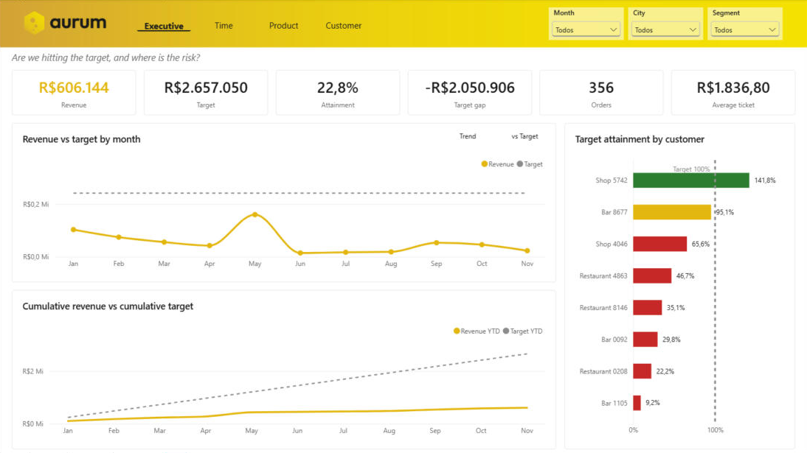
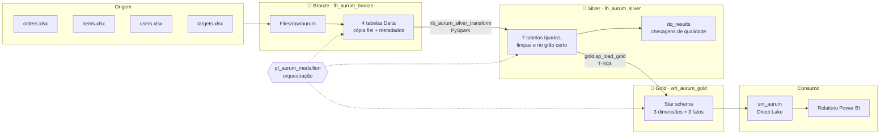
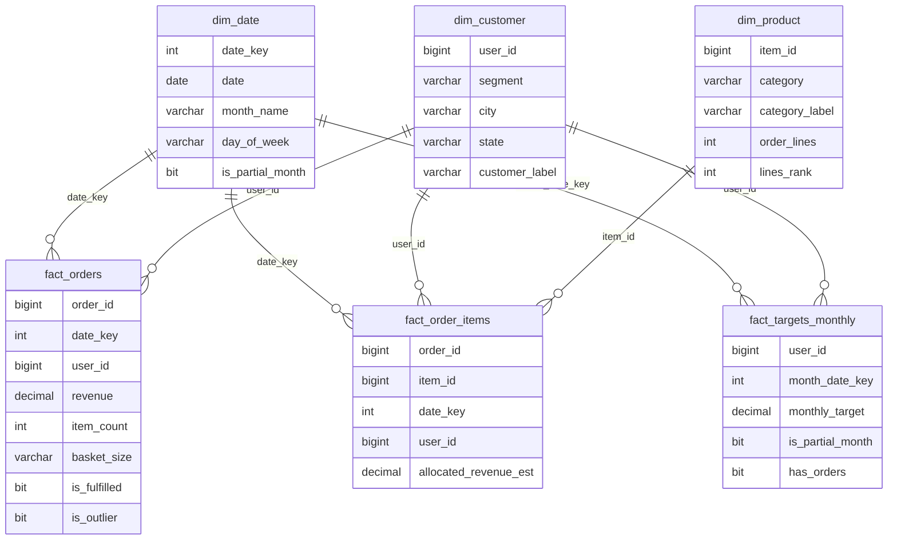
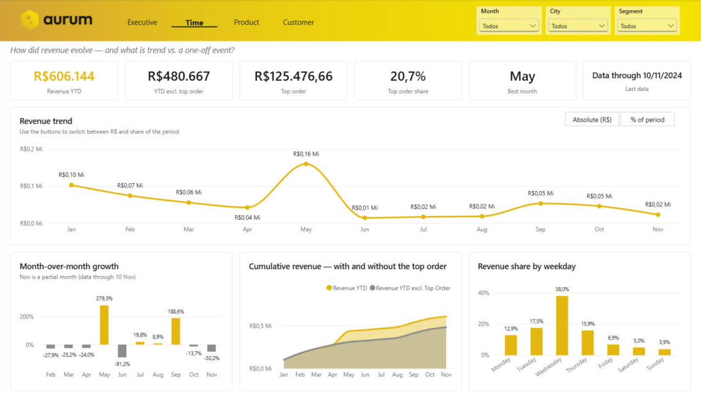
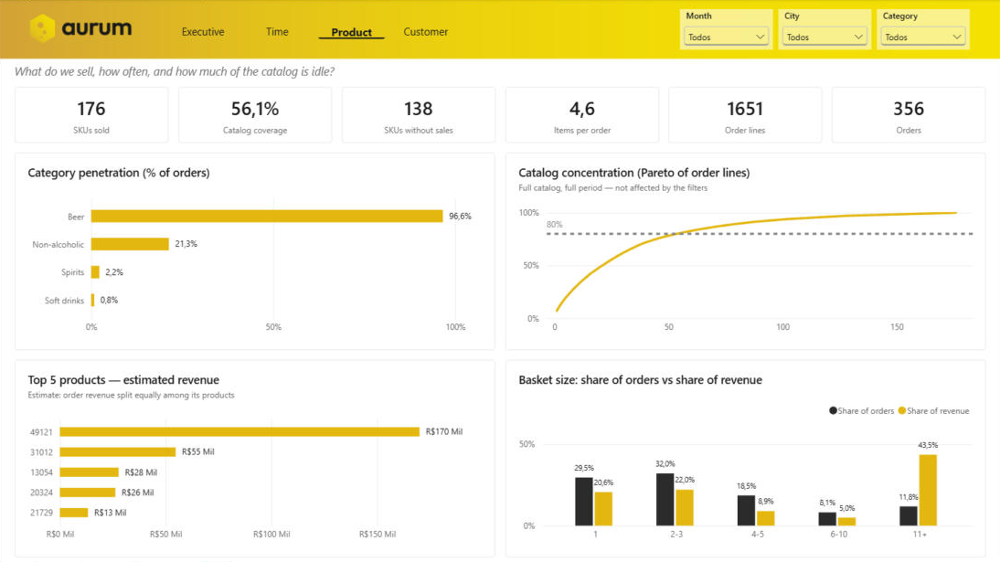
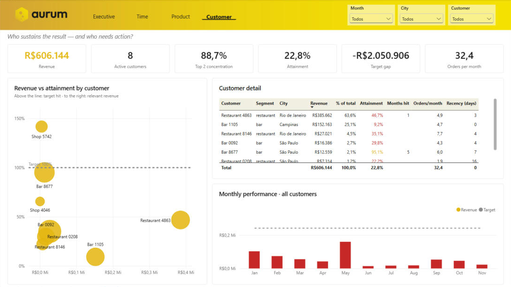

<p align="center">
  
</p>

<h1 align="center">Aurum — Commercial Analytics</h1>

<p align="center">
  Pipeline de dados end-to-end no <strong>Microsoft Fabric</strong> com arquitetura medalhão
  (Bronze → Silver → Gold) e dashboard de gestão comercial no <strong>Power BI</strong>.
</p>

<p align="center">
  
  
  
  
  
</p>

<p align="center">
  
</p>

---

## Sumário

- [Sobre o projeto](#sobre-o-projeto)
- [Arquitetura](#arquitetura)
- [O problema central dos dados](#o-problema-central-dos-dados)
- [Pipeline de dados](#pipeline-de-dados)
- [Modelo dimensional](#modelo-dimensional)
- [Dashboard](#dashboard)
- [Principais insights](#principais-insights)
- [Validação](#validação)
- [Decisões técnicas](#decisões-técnicas)
- [Estrutura do repositório](#estrutura-do-repositório)
- [Próximos passos](#próximos-passos)

---

## Sobre o projeto

A **aurum** é uma distribuidora de bebidas fictícia. A base de dados vem de um case técnico de BI: quatro planilhas Excel com pedidos, catálogo de produtos, clientes e metas mensais de receita de uma carteira de clientes-chave ao longo de 2024.

O case original foi resolvido inteiramente dentro do Power BI, com Power Query. Neste projeto, o mesmo problema foi **reconstruído do zero como engenharia de dados**: a limpeza e a modelagem saíram do relatório e viraram um pipeline versionado, orquestrado e com checagens de qualidade, que entrega um modelo dimensional pronto para consumo.

| | |
|---|---|
| **Tipo de análise** | Gestão comercial (nível tático) |
| **Público** | Gerente comercial / diretoria de vendas |
| **Pergunta central** | Estamos batendo a meta? Onde está o risco e onde agir? |
| **Fonte** | 4 arquivos Excel (1.660 linhas de pedidos, 413 de produtos, 8 clientes) |
| **Período** | 01/01/2024 a 10/11/2024 |

---

## Arquitetura



| Camada | Item no Fabric | Motor | Responsabilidade |
|---|---|---|---|
| Bronze | Lakehouse `lh_aurum_bronze` | PySpark + pandas | Ingerir os Excel sem regra de negócio, tudo como texto, com data de carga e arquivo de origem |
| Silver | Lakehouse `lh_aurum_silver` | PySpark | Tipar, deduplicar, padronizar e colocar cada tabela no seu grão; checar qualidade |
| Gold | Warehouse `wh_aurum_gold` | T-SQL | Modelo dimensional (star schema) com flags e rótulos prontos para o BI |
| Orquestração | Pipeline `pl_aurum_medallion` | — | Rodar Bronze → Silver → Gold em sequência, parando na primeira falha |
| Consumo | Modelo `sm_aurum` + relatório | Direct Lake / DAX | Medidas de negócio e dashboard |

Todo o workspace é versionado neste repositório pela integração Git do Fabric.

---

## O problema central dos dados

Em `orders.xlsx`, **cada linha é um produto do pedido, mas a coluna `revenue` traz o valor do pedido inteiro**, repetido em todas as linhas dele.

```
Soma direta da coluna revenue (1.660 linhas) ... R$ 5.396.656,69   ❌
Receita real (356 pedidos) ..................... R$   606.144,09   ✅
Inflação ....................................... 8,9x
```

A solução foi **estrutural**, não uma regra em cada medida:

- `fact_orders` guarda a receita **no grão de pedido**, onde ela realmente existe;
- `fact_order_items` (pedido × produto) **não tem coluna de receita**.

Assim, é impossível alguém somar receita no grão errado no futuro: a coluna simplesmente não está lá. Como a base não tem quantidade nem preço unitário, a única visão de receita por produto é um **rateio linear explicitamente rotulado como estimativa**.

---

## Pipeline de dados

### 🥉 Bronze — ingestão bruta
[`nb_aurum_bronze_ingest`](fabric/01_bronze/nb_aurum_bronze_ingest.Notebook/notebook-content.py)

- Lê os Excel com pandas (o Spark não lê `.xlsx`) e grava como tabelas Delta com PySpark.
- **Todas as colunas como texto**: tipar é decisão da Silver, onde ela é explícita e revisável.
- Padroniza nomes de coluna (`monthly revenue target` → `monthly_revenue_target`), já que Delta não aceita espaços.
- Adiciona `_ingested_at` e `_source_file` para rastreabilidade.
- Lista de arquivos orientada a metadados (arquivo, aba, tabela de destino): incluir uma nova fonte é uma linha a mais, sem código novo.
- Falha cedo, com mensagem clara, se um arquivo não existir, o que interrompe o pipeline antes das próximas camadas.

### 🥈 Silver — limpeza, tipos e grão
[`nb_aurum_silver_transform`](fabric/02_silver/nb_aurum_silver_transform.Notebook/notebook-content.py)

| # | Problema na base | Tratamento |
|---|---|---|
| 1 | Receita do pedido repetida em cada linha de produto | Tabela no grão de pedido + ponte pedido × produto sem receita |
| 2 | 9 linhas duplicadas em `orders` | `dropDuplicates` depois de tipar (1.660 → 1.651) |
| 3 | 94 duplicatas em `items`, com o mesmo produto às vezes sem categoria | Filtrar nulos **antes** de deduplicar (413 → 314) |
| 4 | `product_id` no pedido × `item_id` no catálogo | Renomeação para casar as chaves |
| 5 | Cidades como “SP”/“RJ” misturadas com nomes completos | Normalização para o nome canônico |
| 6 | Cliente `83095742` sem cidade em `users` | Cidade recuperada de `targets` |
| 7 | Duas fontes de cidade divergentes | `targets` como fonte prioritária (`coalesce`) |
| 8 | “São Paulo” com caractere corrompido em `targets` | Regra por conteúdo (`contains("paulo")`) |
| 9 | “category” significando tipo de cliente e tipo de produto | Cliente passa a usar `segment` |
| 10 | Novembro com apenas 10 dias de dados | Flag `is_partial_month` no calendário |
| 11 | Um calendário até 31/12 mostraria dezembro zerado | Calendário gerado dos dados, até o fim do mês do último pedido |

**Qualidade de dados:** a última etapa do notebook verifica chaves únicas e não nulas em cada tabela, a premissa de receita única por pedido, pedidos órfãos, clientes sem cidade e produtos sem categoria. Regras com severidade `error` **interrompem o pipeline antes da Gold**; avisos (`warning`) apenas registram. O histórico de cada execução fica em `dq_results`.

### 🥇 Gold — modelo dimensional em T-SQL
[`gold.sp_load_gold`](fabric/03_gold/wh_aurum_gold.Warehouse/gold/StoredProcedures/sp_load_gold.sql)

A procedure recarrega o star schema a partir da Silver via **consulta entre bancos** (sem copiar arquivos), dentro de uma transação: se algo falhar, nada fica pela metade. Ela também materializa o que antes era lógica no relatório:

- `is_fulfilled`: 26 pedidos com receita zero (bonificação/cortesia) ficam na base, mas fora do ticket médio;
- `is_outlier`: regra estatística **média + 3 desvios-padrão**, não um ID fixo, que isola o pedido de R$ 125.476,66 (20,7% do ano);
- `basket_size`: faixas de tamanho de cesta;
- `lines_rank`: ranking dos produtos sem empates, para o gráfico de Pareto;
- `customer_label` e `category_label`: rótulos legíveis (“Restaurant 4863”, “Non-alcoholic”);
- `fact_targets_monthly`: meta **cliente × mês**, com `has_orders` para permitir os dois critérios de atingimento.

### Orquestração
[`pl_aurum_medallion`](fabric/pl_aurum_medallion.DataPipeline/pipeline-content.json)

`Ingest Bronze` → `Transform Silver` → `Load Gold`, ligadas por dependência de sucesso: se as checagens de qualidade da Silver falharem, a Gold não é recarregada e o dashboard continua com os dados da última execução válida. A carga é **completa e idempotente**: rodar uma ou dez vezes produz o mesmo resultado.

---

## Modelo dimensional



| Tabela | Grão | Linhas |
|---|---|---:|
| `dim_date` | dia | 335 |
| `dim_customer` | cliente | 8 |
| `dim_product` | produto | 314 |
| `fact_orders` | pedido | 356 |
| `fact_order_items` | pedido × produto | 1.651 |
| `fact_targets_monthly` | cliente × mês | 88 |

O modelo semântico [`sm_aurum`](fabric/sm_aurum.SemanticModel) roda em **Direct Lake** sobre o Warehouse (sem importação nem refresh agendado de dados) e reúne **43 medidas DAX** em 5 pastas: Core, Time, Targets, Product e Customer. Como a Gold já entrega flags, faixas e a meta no grão mensal, as medidas ficaram curtas e legíveis.

---

## Dashboard

Relatório em 4 páginas, cada uma respondendo a uma pergunta de negócio. A paleta segue uma regra única em todo o relatório: **dourado é receita**, **verde só quando a meta foi atingida**, **vermelho só quando está crítica (< 70%)** e **cinza é contexto**.

### Executive — *Estamos batendo a meta? Onde está o risco?*
KPIs de receita, meta, atingimento, gap, pedidos e ticket médio; receita × meta por mês (com alternância entre visão de tendência e de comparação com semáforo); meta acumulada; atingimento por cliente.


### Time — *O que é tendência e o que é evento isolado?*
Tendência com alternância **R$ ⟷ % do período**, crescimento mês a mês, receita acumulada com e sem o pedido atípico e participação por dia da semana.



### Product — *O que vendemos e quanto do catálogo está parado?*
Penetração por categoria, Pareto do catálogo, Top 5 produtos (estimativa rotulada) e tamanho de cesta: participação em pedidos × em receita.



### Customer — *Quem sustenta o resultado e quem precisa de ação?*
Dispersão receita × atingimento, ficha de cada cliente (peso, meta, regularidade, recência) e desempenho mensal do cliente selecionado, com título dinâmico.



---

## Principais insights

1. **A carteira atingiu 22,8% da meta anual** (R$ 606 mil de R$ 2,66 milhões). Nenhum mês chegou perto da meta consolidada.
2. **Um cliente explica a maior parte do gap:** o Bar 1105 (Campinas) tem meta de R$ 150 mil/mês e entrega cerca de R$ 13,8 mil/mês, o que representa **73% do gap total**. Ou a meta está mal calibrada, ou a conta perdeu ~90% do volume.
3. **O +279% de maio não é desempenho:** um único pedido de R$ 125.476,66 representa 20,7% do ano. Sem ele, a receita caiu por cinco meses seguidos (jan → jun) e se recupera desde julho.
4. **Dois clientes concentram 88,7% da receita**, um risco alto de dependência.
5. **Quarta-feira concentra 38,0% da receita**, enquanto quinta e sexta são subaproveitadas: há espaço para redistribuir visitas.
6. **138 dos 314 SKUs (44%) nunca foram vendidos.** Quase metade do catálogo não gira.
7. **Cestas com 11+ itens são 11,8% dos pedidos e 43,5% da receita:** dois perfis de compra convivem, e estratégias de cross-sell genéricas não servem para os dois.

---

## Validação

Os números da Gold foram conferidos contra valores calculados de forma independente a partir dos arquivos de origem.

| Indicador | Valor |
|---|---:|
| Receita total | R$ 606.144,09 |
| Pedidos / faturados | 356 / 330 |
| Ticket médio | R$ 1.836,80 |
| Linhas pedido × produto | 1.651 |
| Produtos no catálogo / vendidos | 314 / 176 |
| Pedido atípico (μ + 3σ) | 1 |
| Meta do período | R$ 2.657.050 |
| Atingimento (período completo) | 22,8% |
| Atingimento (só meses com pedido) | 23,6% |

---

## Decisões técnicas

| Decisão | Motivo |
|---|---|
| **Arquitetura medalhão** | Cada camada é verificável isoladamente: se um número diverge, a investigação vai camada a camada até achar onde o erro entrou. |
| **Carga completa (full load)** | Com 1.660 linhas, recriar tudo leva segundos. Carga incremental faria sentido com volume grande ou necessidade de histórico (SCD2). |
| **Warehouse na Gold** | Modelagem dimensional natural em T-SQL, com transações e procedures, e o projeto usa os dois motores do Fabric. |
| **Chaves naturais** | Não há histórico de mudanças nem fontes com IDs conflitantes, então chave substituta seria complexidade sem ganho. |
| **Outlier por regra estatística** | Um ID fixo quebraria silenciosamente com dados novos; μ + 3σ se recalcula e é auditável. |
| **Dois critérios de meta** | Contar só meses com pedido (23,6%) não penaliza meses sem visita; o período completo (22,8%) trata mês sem compra como 0%. A Gold suporta os dois e o dashboard usa o segundo como principal. |
| **Toggle R$ ⟷ % sem field parameters** | Modelos Direct Lake não aceitam tabelas calculadas; uma tabela de parâmetro de 2 linhas na Gold e uma medida com formato dinâmico fazem o mesmo papel. |
| **Convenção de nomes** | `lh_`, `wh_`, `nb_`, `pl_`, `sm_` + código do projeto + camada, para que cada item seja identificável no catálogo do OneLake mesmo com vários projetos no mesmo tenant. |

---

## Estrutura do repositório

```
fabric/
├── 01_bronze/
│   ├── lh_aurum_bronze.Lakehouse/
│   └── nb_aurum_bronze_ingest.Notebook/       # ingestão Excel → Delta
├── 02_silver/
│   ├── lh_aurum_silver.Lakehouse/
│   └── nb_aurum_silver_transform.Notebook/    # limpeza, grão e qualidade
├── 03_gold/
│   └── wh_aurum_gold.Warehouse/               # tabelas, procedure e view (T-SQL)
├── pl_aurum_medallion.DataPipeline/           # orquestração
├── sm_aurum.SemanticModel/                    # modelo Direct Lake + medidas DAX (TMDL)
└── Aurum - Commercial Management.Report/      # relatório Power BI (PBIR)
docs/
└── img/                                       # prints do dashboard e logo
```

---

## Próximos passos

- Ingestão automática da origem (atividade Copy a partir de SharePoint ou API) no lugar do upload manual.
- Pasta de origem como parâmetro do pipeline e alerta automático (Teams/Outlook) em caso de falha.
- Carga incremental e histórico de clientes (SCD2), caso o volume cresça.
- Testes automatizados de qualidade (por exemplo, Great Expectations) integrados ao pipeline.
- Deploy entre ambientes de desenvolvimento e produção com pipelines de implantação do Fabric.

---

<p align="center">
  Desenvolvido por <a href="https://github.com/JakyLindemberg">Jaky Lindemberg</a> · projeto de portfólio · a marca <strong>aurum</strong> é fictícia.
</p>
