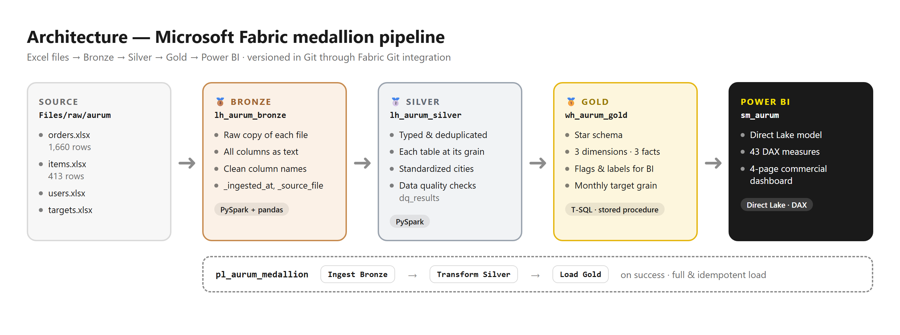
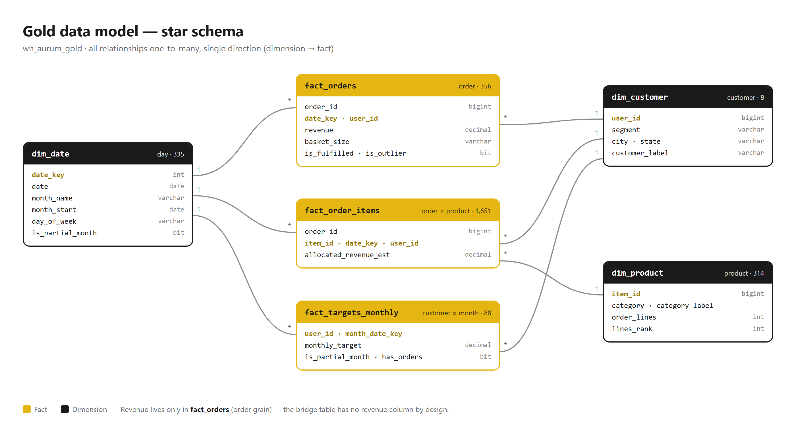

<p align="center">
  <a href="README.md"> <strong>English</strong></a>
  &nbsp;·&nbsp;
  <a href="README.pt-BR.md"> Português</a>
</p>

<p align="center">
  <picture>
    <source media="(prefers-color-scheme: dark)" srcset="docs/img/aurum-logo-white.png">
    
  </picture>
</p>

<h1 align="center">Aurum — Commercial Analytics</h1>

<p align="center">
  End-to-end data pipeline on <strong>Microsoft Fabric</strong> using the medallion architecture
  (Bronze → Silver → Gold), feeding a commercial management dashboard in <strong>Power BI</strong>.
</p>

<p align="center">
  
  
  
  
  
</p>

<p align="center">
  
</p>

---

## Table of contents

- [About the project](#about-the-project)
- [Architecture](#architecture)
- [The core data problem](#the-core-data-problem)
- [Data pipeline](#data-pipeline)
- [Dimensional model](#dimensional-model)
- [Dashboard](#dashboard)
- [Key insights](#key-insights)
- [Validation](#validation)
- [Technical decisions](#technical-decisions)
- [Repository structure](#repository-structure)

---

## About the project

**aurum** is a fictional beverage distributor. The data comes from a BI technical case: four Excel spreadsheets with orders, the product catalog, customers and monthly revenue targets for a portfolio of key accounts throughout 2024.

The original case was solved entirely inside Power BI with Power Query. In this project the same problem was **rebuilt from scratch as data engineering**: cleaning and modeling moved out of the report into a versioned, orchestrated pipeline with data quality checks, which delivers a dimensional model ready for consumption.

| | |
|---|---|
| **Analysis type** | Commercial management (tactical level) |
| **Audience** | Sales manager / sales leadership |
| **Core question** | Are we hitting the target? Where is the risk and where should we act? |
| **Source** | 4 Excel files (1,660 order lines, 413 product rows, 8 customers) |
| **Period** | Jan 1, 2024 to Nov 10, 2024 |

---

## Architecture

<p align="center">
  
</p>

| Layer | Fabric item | Engine | Responsibility |
|---|---|---|---|
| Bronze | Lakehouse `lh_aurum_bronze` | PySpark + pandas | Ingest the Excel files with no business rules, all columns as text, with load timestamp and source file |
| Silver | Lakehouse `lh_aurum_silver` | PySpark | Cast types, deduplicate, standardize and put each table at its grain; run quality checks |
| Gold | Warehouse `wh_aurum_gold` | T-SQL | Dimensional model (star schema) with flags and labels ready for BI |
| Orchestration | Pipeline `pl_aurum_medallion` | — | Run Bronze → Silver → Gold in sequence, stopping at the first failure |
| Consumption | `sm_aurum` model + report | Direct Lake / DAX | Business measures and dashboard |

The whole workspace is versioned in this repository through Fabric Git integration.

---

## The core data problem

In `orders.xlsx`, **each row is one product of an order, but the `revenue` column holds the value of the whole order**, repeated on every one of its rows.

```
Plain sum of the revenue column (1,660 rows) ... R$ 5,396,656.69   ❌
Actual revenue (356 orders) .................... R$   606,144.09   ✅
Inflation ...................................... 8.9x
```

The fix is **structural**, not a rule repeated in every measure:

- `fact_orders` stores revenue **at order grain**, where it actually exists;
- `fact_order_items` (order × product) **has no revenue column at all**.

This makes it impossible for anyone to sum revenue at the wrong grain later: the column simply is not there. Since the source has no quantity or unit price, the only revenue-by-product view is an **equal split per order, explicitly labeled as an estimate**.

---

## Data pipeline

### 🥉 Bronze — raw ingestion
[`nb_aurum_bronze_ingest`](fabric/01_bronze/nb_aurum_bronze_ingest.Notebook/notebook-content.py)

- Reads the Excel files with pandas (Spark cannot read `.xlsx`) and writes Delta tables with PySpark.
- **All columns as text**: typing is a Silver decision, where it is explicit and reviewable.
- Standardizes column names (`monthly revenue target` → `monthly_revenue_target`), since Delta does not accept spaces.
- Adds `_ingested_at` and `_source_file` for lineage.
- Metadata-driven file list (file, sheet, target table): adding a new source is one more line, no new code.
- Fails fast with a clear message if a file is missing, stopping the pipeline before the next layers.

### 🥈 Silver — cleaning, types and grain
[`nb_aurum_silver_transform`](fabric/02_silver/nb_aurum_silver_transform.Notebook/notebook-content.py)

| # | Issue in the source | Treatment |
|---|---|---|
| 1 | Order revenue repeated on every product line | Order-grain table + order × product bridge without revenue |
| 2 | 9 exact duplicate rows in `orders` | `dropDuplicates` after casting types (1,660 → 1,651) |
| 3 | 94 duplicates in `items`, with the same product sometimes missing its category | Filter nulls **before** deduplicating (413 → 314) |
| 4 | `product_id` in orders vs `item_id` in the catalog | Rename so the keys match |
| 5 | Cities as “SP”/“RJ” mixed with full names | Normalization to the canonical name |
| 6 | Customer `83095742` with no city in `users` | City recovered from `targets` |
| 7 | Two diverging city sources | `targets` as the priority source (`coalesce`) |
| 8 | “São Paulo” with a corrupted character in `targets` | Content-based rule (`contains("paulo")`) |
| 9 | “category” meaning both customer type and product type | Customers use `segment` instead |
| 10 | November has only 10 days of data | `is_partial_month` flag in the calendar |
| 11 | A calendar through Dec 31 would show an empty December | Calendar generated from the data, ending at the last order's month |

**Data quality:** the last step of the notebook checks unique, non-null keys in every table, the one-revenue-per-order assumption, orphan orders, customers without a city and products without a category. `error` rules **stop the pipeline before Gold**; `warning` rules are only logged. Every run is recorded in `dq_results`.

### 🥇 Gold — dimensional model in T-SQL
[`gold.sp_load_gold`](fabric/03_gold/wh_aurum_gold.Warehouse/gold/StoredProcedures/sp_load_gold.sql)

The procedure reloads the star schema from Silver through **cross-database queries** (no file copies), inside a transaction: if anything fails, nothing is left half-loaded. It also materializes what used to be logic inside the report:

- `is_fulfilled`: 26 zero-revenue orders (bonuses/courtesy) stay in the data but out of the average ticket;
- `is_outlier`: a **mean + 3 standard deviations** rule, not a hard-coded ID, which isolates the R$ 125,476.66 order (20.7% of the year);
- `basket_size`: basket size bands;
- `lines_rank`: tie-free product ranking for the Pareto chart;
- `customer_label` and `category_label`: readable labels (“Restaurant 4863”, “Non-alcoholic”);
- `fact_targets_monthly`: target at **customer × month** grain, with `has_orders` to support both attainment criteria.

### Orchestration
[`pl_aurum_medallion`](fabric/pl_aurum_medallion.DataPipeline/pipeline-content.json)

`Ingest Bronze` → `Transform Silver` → `Load Gold`, chained by on-success dependencies: if the Silver quality checks fail, Gold is not reloaded and the dashboard keeps the data from the last valid run. The load is **full and idempotent**: running it once or ten times produces the same result.

---

## Dimensional model

<p align="center">
  
</p>

| Table | Grain | Rows |
|---|---|---:|
| `dim_date` | day | 335 |
| `dim_customer` | customer | 8 |
| `dim_product` | product | 314 |
| `fact_orders` | order | 356 |
| `fact_order_items` | order × product | 1,651 |
| `fact_targets_monthly` | customer × month | 88 |

The [`sm_aurum`](fabric/sm_aurum.SemanticModel) semantic model runs in **Direct Lake** on top of the Warehouse (no import, no scheduled data refresh) and holds **43 DAX measures** in 5 folders: Core, Time, Targets, Product and Customer. Because Gold already delivers flags, bands and the monthly target grain, the measures stay short and readable.

---

## Dashboard

A 4-page report, each page answering one business question. The palette follows a single rule across the report: **gold is revenue**, **green only when the target was hit**, **red only when it is critical (< 70%)** and **grey is context**.

### Executive — *Are we hitting the target, and where is the risk?*
KPIs for revenue, target, attainment, gap, orders and average ticket; revenue vs target by month (switching between a trend view and a traffic-light comparison); cumulative target; attainment by customer.


### Time — *What is trend and what is a one-off event?*
Trend with an **R$ ⟷ % of period** toggle, month-over-month growth, cumulative revenue with and without the outlier order, and revenue share by weekday.


### Product — *What do we sell, and how much of the catalog is idle?*
Category penetration, catalog Pareto, Top 5 products (labeled estimate) and basket size: share of orders vs share of revenue.


### Customer — *Who sustains the result, and who needs action?*
Revenue vs attainment scatter, a detail row per customer (weight, target, regularity, recency) and the selected customer's monthly performance with a dynamic title.


---

## Key insights

1. **The portfolio reached 22.8% of its annual target** (R$ 606k of R$ 2.66M). No month came close to the consolidated target.
2. **One customer explains most of the gap:** Bar 1105 (Campinas) has a target of R$ 150k/month and delivers about R$ 13.8k/month — **73% of the total gap**. Either the target is miscalibrated or the account lost ~90% of its volume.
3. **May's +279% is not performance:** a single R$ 125,476.66 order is 20.7% of the year's revenue. Without it, revenue fell for five consecutive months (Jan → Jun) and has been recovering since July.
4. **Two customers concentrate 88.7% of revenue**, a high dependency risk.
5. **Wednesday concentrates 38.0% of revenue**, while Thursday and Friday are underused: there is room to redistribute sales visits.
6. **138 of 314 SKUs (44%) never sold.** Almost half of the catalog has no turnover.
7. **Baskets with 11+ items are 11.8% of orders but 43.5% of revenue:** two buying profiles coexist, and generic cross-sell strategies do not fit both.

---

## Validation

Gold figures were checked against values computed independently from the source files.

| Metric | Value |
|---|---:|
| Total revenue | R$ 606,144.09 |
| Orders / fulfilled | 356 / 330 |
| Average ticket | R$ 1,836.80 |
| Order × product lines | 1,651 |
| Catalog products / sold | 314 / 176 |
| Outlier orders (μ + 3σ) | 1 |
| Target for the period | R$ 2,657,050 |
| Attainment (full period) | 22.8% |
| Attainment (months with orders only) | 23.6% |

---

## Technical decisions

| Decision | Rationale |
|---|---|
| **Medallion architecture** | Each layer can be verified on its own: when a number diverges, the investigation goes layer by layer until it finds where the error came in. |
| **Full load** | With 1,660 static rows, rebuilding everything takes seconds and keeps the process simple and idempotent. |
| **Warehouse for Gold** | Dimensional modeling is natural in T-SQL, with transactions and procedures, and the project uses both Fabric engines. |
| **Natural keys** | There is no change history and no sources with conflicting IDs, so surrogate keys would add complexity with no gain. |
| **Statistical outlier rule** | A hard-coded ID would silently break with new data; μ + 3σ recalculates itself and is auditable. |
| **Two target criteria** | Counting only months with orders (23.6%) does not penalize months without visits; the full period (22.8%) treats a month without purchases as 0%. Gold supports both and the dashboard uses the latter as the main one. |
| **R$ ⟷ % toggle without field parameters** | Direct Lake models do not accept calculated tables; a 2-row parameter table in Gold plus a measure with a dynamic format string does the same job. |
| **Naming convention** | `lh_`, `wh_`, `nb_`, `pl_`, `sm_` + project code + layer, so every item is identifiable in the OneLake catalog even with several projects in the same tenant. |

---

## Repository structure

```
fabric/
├── 01_bronze/
│   ├── lh_aurum_bronze.Lakehouse/
│   └── nb_aurum_bronze_ingest.Notebook/       # Excel → Delta ingestion
├── 02_silver/
│   ├── lh_aurum_silver.Lakehouse/
│   └── nb_aurum_silver_transform.Notebook/    # cleaning, grain and quality
├── 03_gold/
│   └── wh_aurum_gold.Warehouse/               # tables, procedure and view (T-SQL)
├── pl_aurum_medallion.DataPipeline/           # orchestration
├── sm_aurum.SemanticModel/                    # Direct Lake model + DAX measures (TMDL)
└── Aurum - Commercial Management.Report/      # Power BI report (PBIR)
docs/
└── img/                                       # diagrams, dashboard screenshots and logo
```

---

<p align="center">
  Built by <a href="https://github.com/JakyLindemberg">Jaky Lindemberg</a> · portfolio project · <strong>aurum</strong> is a fictional brand.
</p>
